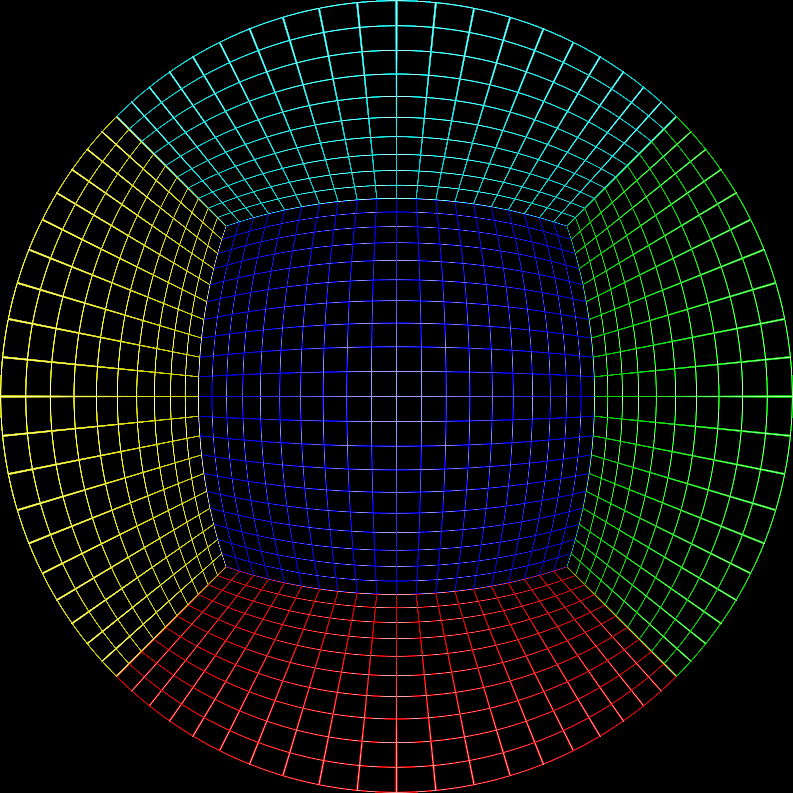
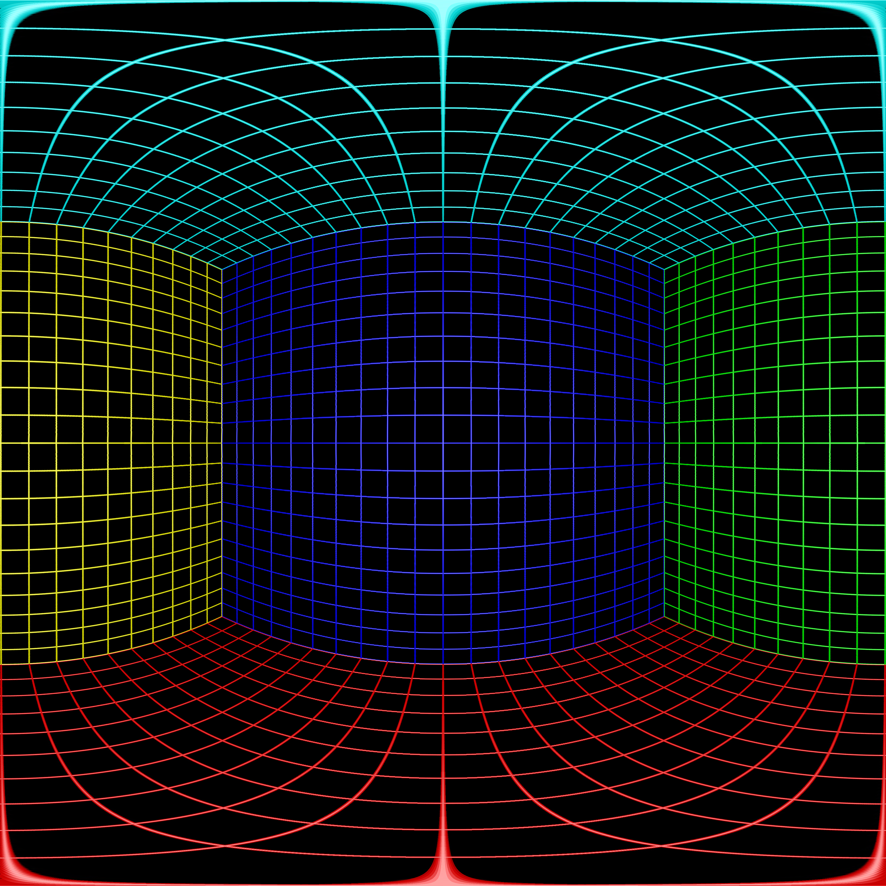

# Camera calibration (Gear 360)

Python tools to **fit lens and stitch parameters** from stills or video and write a **`calibration.toml`** that the **C++** (`cpp_player`) and **Python** (`python_player`) viewers can load.

- **`calib/`** — Main entrypoint `create_calibration.py` (image/video/preset/JSON → TOML), config helpers, and mask utilities.
- **`solvers/`** — Optimization backends (e.g. adjoint, plumbline, feature-based) and shared helpers like `tracking.py`.
- **`projections/`** — Fisheye → equirectangular / rectilinear reference code used in the pipeline.
- **`transformations/`** — Image geometry helpers (e.g. edge handling).

### Example projections (`images/`)

Single-lens fisheye input and the two **`projections/`** outputs. On disk: rectilinear uses `single_lens_rectilinear.png`; equirectangular uses `single_lens_equarectangular.png` (filename keeps the old “equarectangular” spelling).

If a preview still looks wrong after you swap or replace PNGs, reload the Markdown preview or restart the editor—many UIs cache image binaries by path. On GitHub, push the commit and hard-refresh the page (`Ctrl+F5`).

**Input (fisheye)** — `single_lens.png`



**Rectilinear** — `single_lens_rectilinear.png`


**Equirectangular** — `single_lens_equarectangular.png`



Quick start: from `calib/`, run `create_calibration.py` with `--help`, or see the module docstring at the top of `create_calibration.py`.

### Stitch a video

`realtime/stitcher.py` writes a video from a side-by-side clip and a calibration file. Rectilinear and 360 call `projections/stitch_dual_fisheye` with that file on every frame, so the seam stays fixed. The default format, `fisheye`, copies the original frames and does not need a calibration file.

```bash
python camera_calibration/realtime/stitcher.py clip.mp4 --calibration calibration.toml --output_format 360 -o clip_360.mp4
python camera_calibration/realtime/stitcher.py clip.mp4 --calibration calibration.toml --output_format rectalinear
```

`360` is equirectangular and tagged so a 360 player can look around. `rectalinear` is a flat view. The Python viewer uses the same TOML when its Stitch control is on.

`RealtimeStitcher` can still estimate a seam shift per frame. The commands above do not use it.

Accuracy of that per-frame estimator is checked against a known synthetic panorama: at least 99 percent of usable seam pixels must fall within 8 gray levels of the source. Run:

```bash
py -3.12 -m unittest camera_calibration.tests.test_realtime_stitch -v
```
